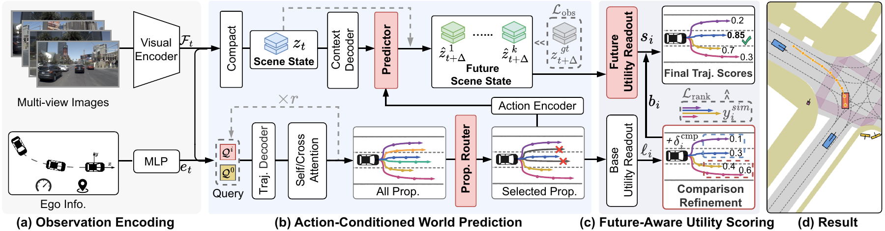
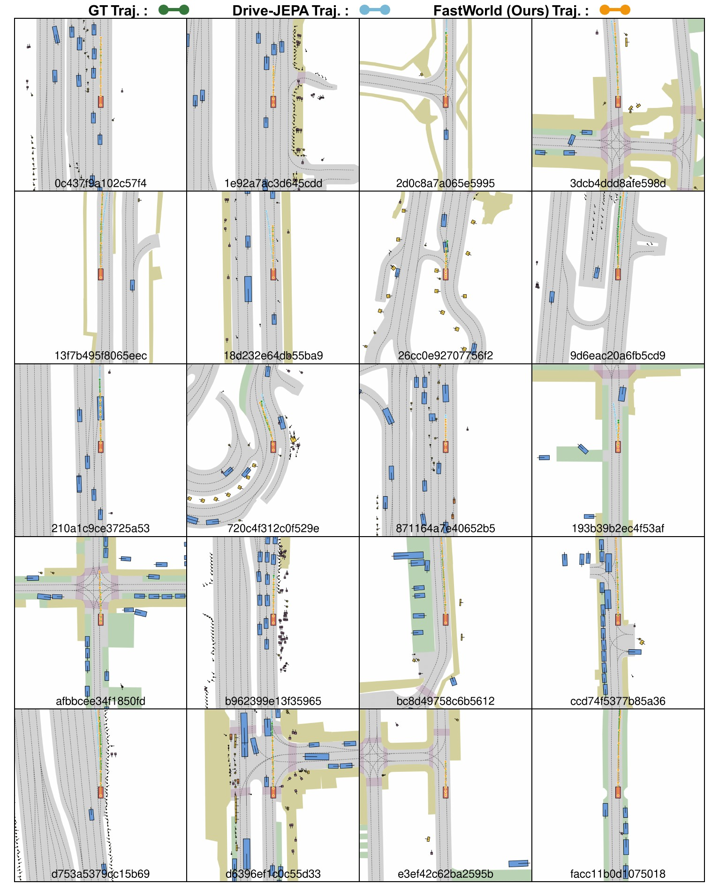
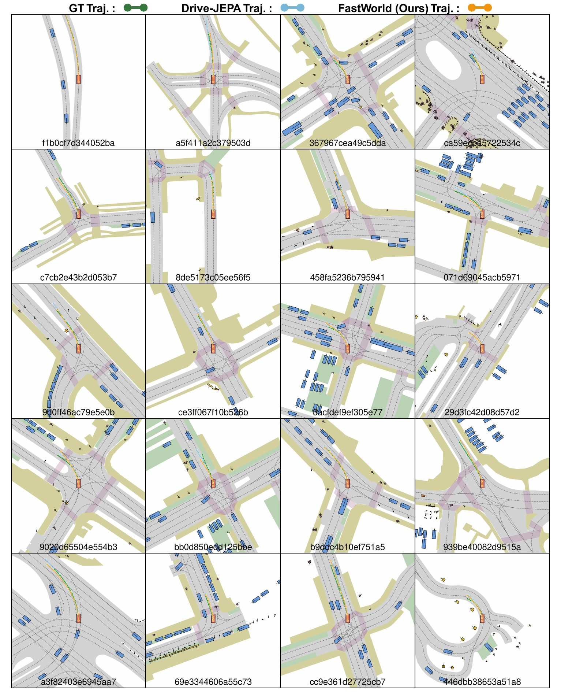
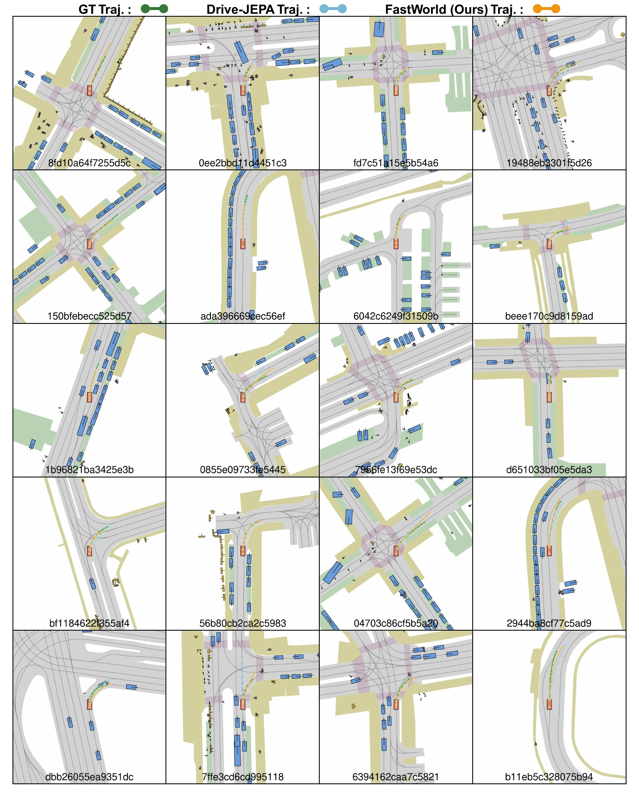
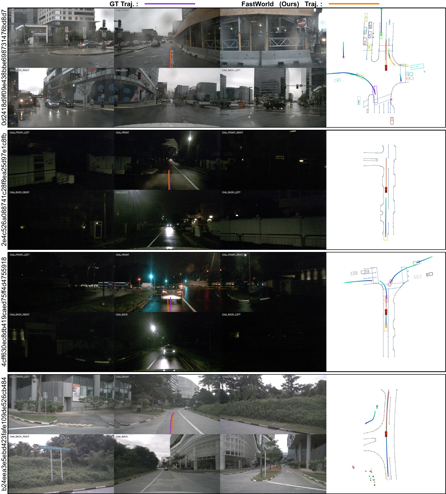
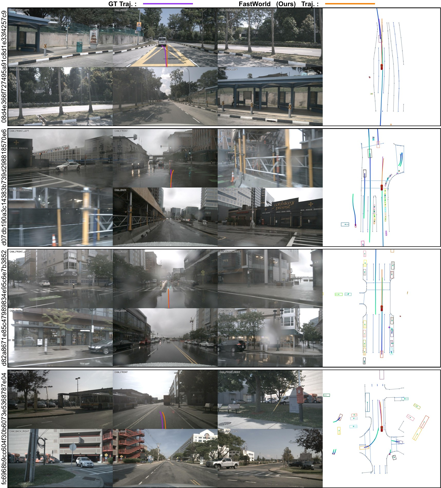
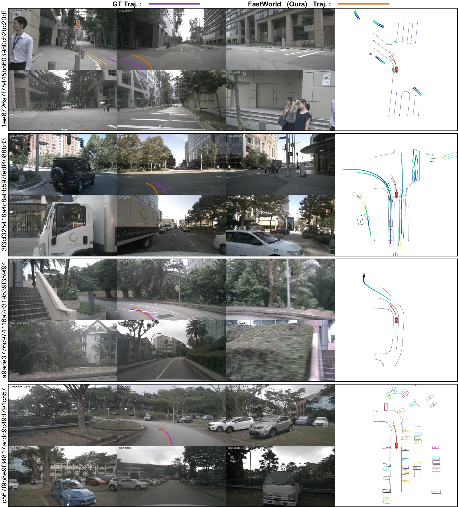
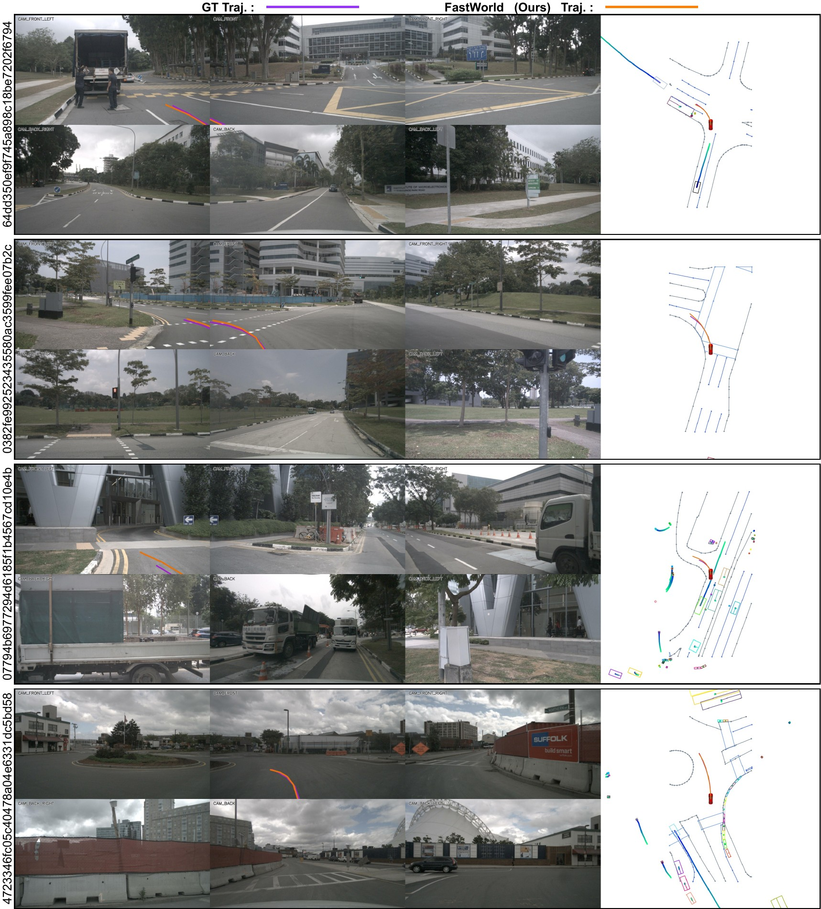
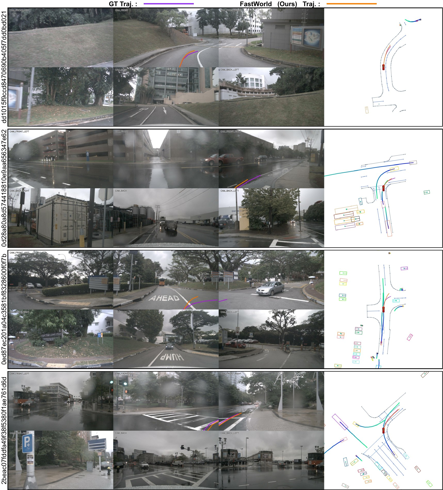
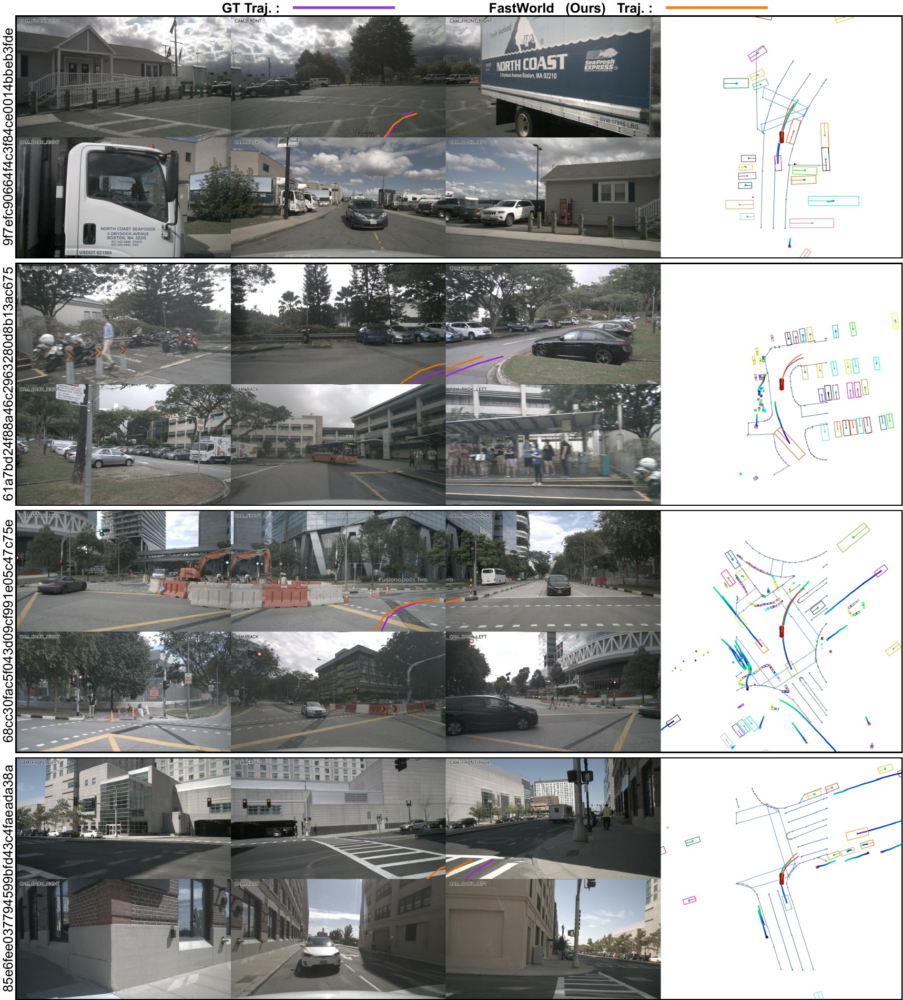

<div align="center">

# 

### Imagine Smarter, Drive Faster:<br>Efficient World Modeling for Decision-Aware Autonomous Driving

**[Feiyang Jia](https://openreview.net/profile?id=~Feiyang_Jia1)<sup>1,†</sup> · [Lin Liu](https://openreview.net/profile?id=~Lin_Liu12)<sup>2,†</sup> · [Zhicheng Bao](https://openreview.net/profile?id=~ZhiCheng_Bao4)<sup>1,†</sup> · [Caiyan Jia](https://openreview.net/profile?id=~Caiyan_Jia1)<sup>1,&#42;</sup><br>
[Ziying Song](https://openreview.net/profile?id=~Ziying_Song1)<sup>3,&#42;</sup> · [Shengkai Zhang](https://openreview.net/profile?id=~Shengkai_Zhang4)<sup>1</sup> · [Lina Han](https://openreview.net/profile?id=~lina_han1)<sup>1</sup> · [Yan Zhao](https://openreview.net/profile?id=~Yan_Zhao16)<sup>1</sup> · [Xiaoshuai Hao](https://openreview.net/profile?id=~Xiaoshuai_Hao1)<sup>4,‡</sup>**

<sup>1</sup> Beijing Jiaotong University · <sup>2</sup> Dalian University of Technology ·
<sup>3</sup> Nanyang Technological University · <sup>4</sup> Li Auto Inc.

<sub>† Equal contribution · &#42; Corresponding author · ‡ Project lead</sub>

[](https://arxiv.org/abs/2611.28779)

</div>

[Method](#method) · [Results and checkpoints](#results-and-checkpoints) · [Quick start](#quick-start) · [Visualizations](#qualitative-results)

FastWorld uses compact scene representations to predict future states for
candidate trajectories. The planner generates 64 proposals, verifies 16, and
uses the predicted future states to refine their scores. This repository
provides inference for NAVSIM v1 NAVTEST and nuScenes validation.


## Method



## Results and checkpoints

### NAVSIM v1 NAVTEST

| Model | Benchmark | Backbone | NC ↑ | DAC ↑ | TTC ↑ | Comfort ↑ | EP ↑ | PDMS ↑ | FPS ↑ (RTX 4090) | Checkpoint |
| --- | --- | --- | ---: | ---: | ---: | ---: | ---: | ---: | ---: | --- |
| FastWorld | NAVSIM v1 NAVTEST | ResNet-34 | 98.5 | 98.0 | 94.6 | 99.9 | 89.9 | **92.2** | 132 | [Google Drive](https://drive.google.com/file/d/17ajsxTVtJBcGohSmCtlDpiOhUfYgV_Aq/view?usp=sharing) |

Metrics use a 0–100 scale across 12,146 NAVTEST scenes. FPS is reported on one
RTX 4090. The released code and checkpoint reproduced 92.1988 PDMS on
all 12,146 scenes with the official NAVSIM v1.1 evaluator. The checkpoint includes
the ResNet-34 weights.

### nuScenes validation

| Model | Backbone | L2 1 s ↓ | L2 2 s ↓ | L2 3 s ↓ | L2 avg. ↓ | Collision 1 s ↓ | Collision 2 s ↓ | Collision 3 s ↓ | Collision avg. ↓ | FPS ↑ (RTX 4090) | Checkpoint |
| --- | --- | ---: | ---: | ---: | ---: | ---: | ---: | ---: | ---: | ---: | --- |
| FastWorld | Swin-T | 0.21 | 0.37 | 0.63 | **0.40** | 0.10% | 0.30% | 0.52% | **0.31%** | 17 | [Google Drive](https://drive.google.com/file/d/1_pobEoW2SNTtdXxtZJAlqeSJLZa4dJpv/view?usp=sharing) |

L2 is in meters. L2 and box collision use LAW's temporal-prefix averaging over
the 5,119 valid 3-second futures in the 6,019-sample validation set. The paper
reports 17 FPS on one RTX 4090.

## Quick start

- [NAVSIM v1](#navsim-v1) covers environment setup, NAVTEST data, and inference.
- [nuScenes](fastworld_nus/README.md#quick-start) covers environment setup, data preparation, inference, and validation metrics.

### NAVSIM v1

#### 1. Install

Use Linux x86-64, Python 3.9, an NVIDIA GPU, and the CUDA 12.1 toolkit to build
MMCV's CUDA operators. The model uses PyTorch 2.1.0 with CUDA 12.1.

```bash
git clone https://github.com/MoyangSensei/FastWorld.git
cd FastWorld

conda create -n fastworld python=3.9 -y
conda activate fastworld

git clone --branch v1.1 --depth 1 https://github.com/autonomousvision/navsim.git ../navsim-v1.1
export NAVSIM_DEVKIT_ROOT="$(realpath ../navsim-v1.1)"

python -m pip install torch==2.1.0 torchvision==0.16.0 --index-url https://download.pytorch.org/whl/cu121
python -m pip install 'setuptools==65.5.1' wheel ninja packaging
python -m pip install -r requirements.txt

# Set CUDA_HOME to the CUDA 12.1 toolkit location. Change 8.9 for other GPU architectures.
export CUDA_HOME=/usr/local/cuda-12.1
MMCV_WITH_OPS=1 FORCE_CUDA=1 TORCH_CUDA_ARCH_LIST=8.9 \
  python -m pip install --no-build-isolation 'git+https://github.com/open-mmlab/mmcv.git@v1.7.2'

python -m pip install --no-deps -e "$NAVSIM_DEVKIT_ROOT"
```

#### 2. Prepare NAVTEST and the checkpoint

Download the NAVSIM v1 test logs, test sensor blobs, and nuPlan maps using the
[NAVSIM v1 dataset instructions](https://github.com/autonomousvision/navsim/blob/v1.1/docs/install.md).
Point the following variables at your installation.

```bash
export OPENSCENE_DATA_ROOT=/path/to/navsim/dataset
export NUPLAN_MAPS_ROOT="$OPENSCENE_DATA_ROOT/maps"
export NUPLAN_MAP_VERSION=nuplan-maps-v1.0
export NAVSIM_EXP_ROOT="$(pwd)/exp"

mkdir -p checkpoints "$NAVSIM_EXP_ROOT"
```

Place the Google Drive download at `checkpoints/fastworld_navsim_v1_92p2.pt`.
Set `FASTWORLD_CHECKPOINT` to the file's absolute path to load it from another
directory. Its SHA-256 is
`fbf8caa54e3f6a4a0770b51233a33b64bdeea7afe6241adac2eadab17d5f0a11`.

Build the metric cache once if your NAVTEST data has not been cached.

```bash
python "$NAVSIM_DEVKIT_ROOT/navsim/planning/script/run_metric_caching.py" \
  train_test_split=navtest worker=sequential
```

#### 3. Run inference on NAVTEST

```bash
CUDA_VISIBLE_DEVICES=0 bash scripts/run_navtest.sh
```

The NAVSIM evaluator writes one CSV with per-scene scores and an average row.
A complete run should have 12,146 valid scene rows and a mean score of
approximately `0.922`. For a quick check, run the same script with
`train_test_split.scene_filter.max_scenes=10`.

## Qualitative results

### NAVSIM


<details>
<summary>More NAVSIM examples · straight roads and turns</summary>







</details>

<details>
<summary>Proposal potential and trajectory selection on 100 NAVTEST scenes</summary>


</details>

### nuScenes



<details>
<summary>More nuScenes examples · straight roads and turns</summary>











</details>

## Work Log

- **2026-11-23** — Created the repository and released inference code and checkpoints for NAVSIM v1 and nuScenes.
- **2026-11-24** — The FastWorld preprint became available on [arXiv](https://arxiv.org/abs/2611.28779).

## Acknowledgements

This work builds on [NAVSIM](https://github.com/autonomousvision/navsim),
[Drive-JEPA](https://github.com/linhanwang/Drive-JEPA), and
[BEVFormer](https://github.com/fundamentalvision/BEVFormer). The nuScenes
implementation uses [LAW](https://github.com/BraveGroup/LAW).
The BEVFormer components under `src/fastworld/models/bevformer` were adapted
for FastWorld. The upstream [Apache 2.0 license](licenses/Apache-2.0.txt) applies
to those components.

## Citation

```bibtex
@misc{jia2026imaginesmarterdrivefaster,
      title={Imagine Smarter, Drive Faster: Efficient World Modeling for Decision-Aware Autonomous Driving},
      author={Feiyang Jia and Lin Liu and Zhicheng Bao and Caiyan Jia and Ziying Song and Shengkai Zhang and Lina Han and Yan Zhao and Xiaoshuai Hao},
      year={2026},
      eprint={2611.28779},
      archivePrefix={arXiv},
      primaryClass={cs.CV},
      url={https://arxiv.org/abs/2611.28779},
}
```
