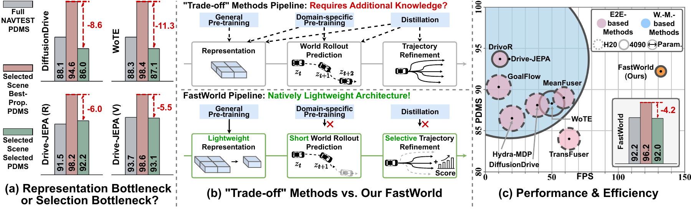
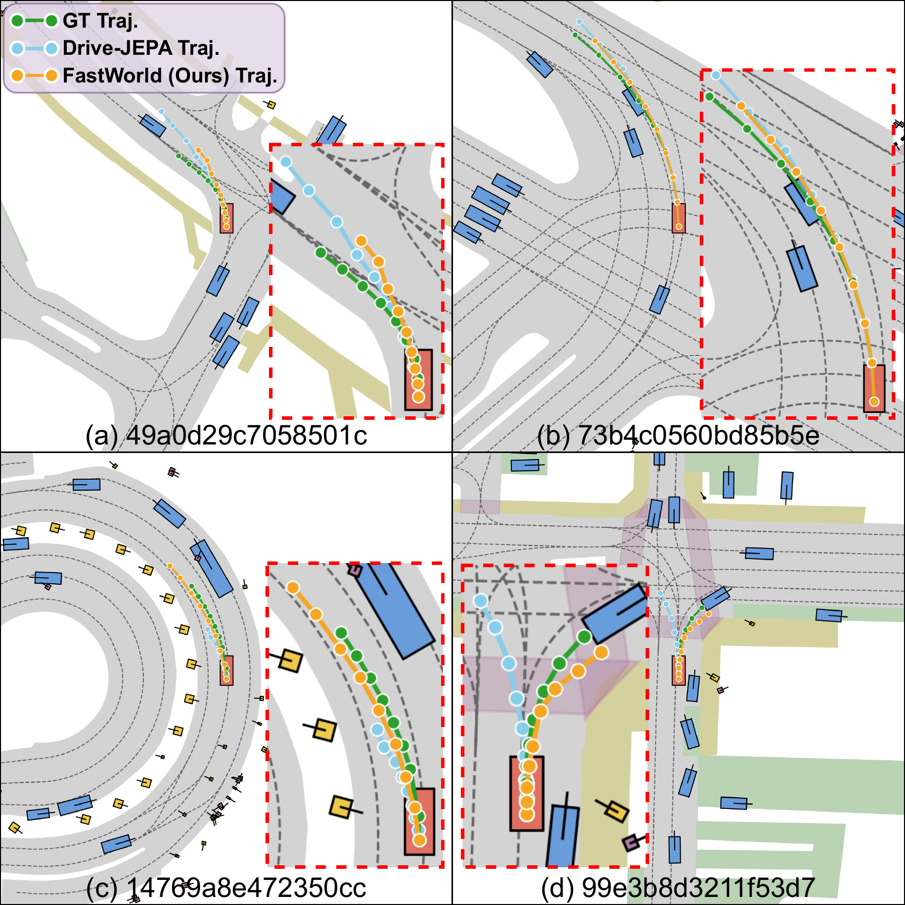
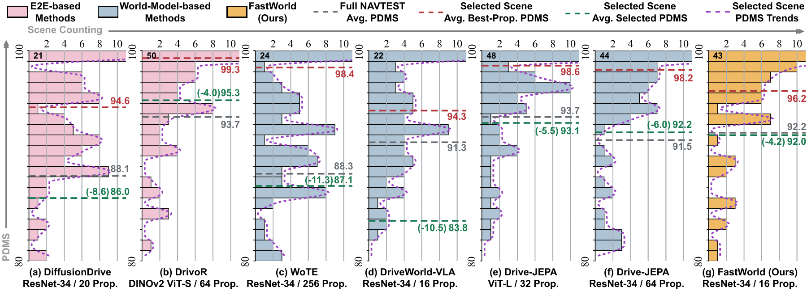

# FastWorld

### Imagine Smarter, Drive Faster: Efficient World Modeling for Decision-Aware Autonomous Driving

Feiyang Jia<sup>1,†</sup>, Lin Liu<sup>2,†</sup>, Zhicheng Bao<sup>1,†</sup>,
Caiyan Jia<sup>1,&#42;</sup>, Ziying Song<sup>3,&#42;</sup>, Shengkai Zhang<sup>1</sup>,
Lina Han<sup>1</sup>, Yan Zhao<sup>1</sup>, Xiaoshuai Hao<sup>4,‡</sup>

<sup>1</sup> Beijing Jiaotong University · <sup>2</sup> Dalian University of Technology ·
<sup>3</sup> Nanyang Technological University · <sup>4</sup> Li Auto Inc.

<sub>† Equal contribution · &#42; Corresponding author · ‡ Project lead</sub>

**arXiv** (coming soon) · [Results and checkpoint](#results-and-checkpoint) · [Quick start](#quick-start)

<!-- Replace the arXiv placeholder with the paper link once available. -->

FastWorld plans with a compact scene representation and predicts how the scene
will evolve over the next second for each verified trajectory. It generates 64
proposals, verifies 16, and uses the predicted future states to refine their
scores. This repository provides the NAVSIM v1 NAVTEST inference release.



## Method


## Results and checkpoint

| Model | Benchmark | Backbone | NC ↑ | DAC ↑ | TTC ↑ | Comfort ↑ | EP ↑ | PDMS ↑ | Checkpoint |
| --- | --- | --- | ---: | ---: | ---: | ---: | ---: | ---: | --- |
| FastWorld | NAVSIM v1 NAVTEST | ResNet-34 | 98.5 | 98.0 | 94.6 | 99.9 | 89.9 | **92.2** | Google Drive (coming soon) |

<!-- Replace the checkpoint cell with [Google Drive](URL). -->

Metrics use a 0–100 scale across 12,146 NAVTEST scenes. The paper reports 132 FPS
on one RTX 4090. The released code and checkpoint reproduced 92.1988 PDMS on
all 12,146 scenes with the official NAVSIM v1.1 evaluator. The checkpoint includes
the ResNet-34 weights.

## Quick start

### 1. Install

Use Linux x86-64, Python 3.9, an NVIDIA GPU, and the CUDA 12.1 toolkit to build
MMCV's CUDA operators. The model uses PyTorch 2.1.0 with CUDA 12.1.

```bash
git clone https://github.com/MoyangSensei/FastWorld.git
cd FastWorld

conda create -n fastworld python=3.9 -y
conda activate fastworld

git clone --branch v1.1 --depth 1 https://github.com/autonomousvision/navsim.git ../navsim-v1.1
export NAVSIM_DEVKIT_ROOT="$(realpath ../navsim-v1.1)"

python -m pip install torch==2.1.0 torchvision==0.16.0 --index-url https://download.pytorch.org/whl/cu121
python -m pip install 'setuptools==65.5.1' wheel ninja packaging
python -m pip install -r requirements.txt

# Set CUDA_HOME to the CUDA 12.1 toolkit location. Change 8.9 for other GPU architectures.
export CUDA_HOME=/usr/local/cuda-12.1
MMCV_WITH_OPS=1 FORCE_CUDA=1 TORCH_CUDA_ARCH_LIST=8.9 \
  python -m pip install --no-build-isolation 'git+https://github.com/open-mmlab/mmcv.git@v1.7.2'

python -m pip install --no-deps -e "$NAVSIM_DEVKIT_ROOT"
```

### 2. Prepare NAVTEST and the checkpoint

Download the NAVSIM v1 test logs, test sensor blobs, and nuPlan maps using the
[NAVSIM v1 dataset instructions](https://github.com/autonomousvision/navsim/blob/v1.1/docs/install.md).
Point the following variables at your installation.

```bash
export OPENSCENE_DATA_ROOT=/path/to/navsim/dataset
export NUPLAN_MAPS_ROOT="$OPENSCENE_DATA_ROOT/maps"
export NUPLAN_MAP_VERSION=nuplan-maps-v1.0
export NAVSIM_EXP_ROOT="$(pwd)/exp"

mkdir -p checkpoints "$NAVSIM_EXP_ROOT"
```

Place the Google Drive download at `checkpoints/fastworld_navsim_v1_92p2.pt`.
Set `FASTWORLD_CHECKPOINT` to the file's absolute path to load it from another
directory. Its SHA-256 is
`fbf8caa54e3f6a4a0770b51233a33b64bdeea7afe6241adac2eadab17d5f0a11`.

Build the metric cache once if your NAVTEST data has not been cached.

```bash
python "$NAVSIM_DEVKIT_ROOT/navsim/planning/script/run_metric_caching.py" \
  train_test_split=navtest worker=sequential
```

### 3. Run inference on NAVTEST

```bash
CUDA_VISIBLE_DEVICES=0 bash scripts/run_navtest.sh
```

The NAVSIM evaluator writes one CSV with per-scene scores and an average row.
A complete run should have 12,146 valid scene rows and a mean score of
approximately `0.922`. For a quick check, run the same script with
`train_test_split.scene_filter.max_scenes=10`.

## Qualitative results



<details>
<summary>Proposal potential and trajectory selection on 100 NAVTEST scenes</summary>



</details>

## Acknowledgements

This work builds on [NAVSIM](https://github.com/autonomousvision/navsim),
[Drive-JEPA](https://github.com/linhanwang/Drive-JEPA), and
[BEVFormer](https://github.com/fundamentalvision/BEVFormer).
The BEVFormer components under `src/fastworld/models/bevformer` were adapted
for FastWorld. The upstream [Apache 2.0 license](licenses/Apache-2.0.txt) applies
to those components.

## Citation

BibTeX will be added when the paper is available.

<!-- Add the final BibTeX entry here. -->
